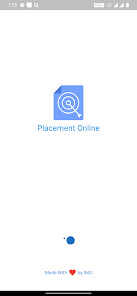
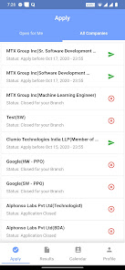
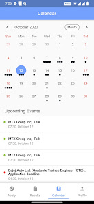
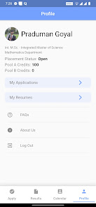
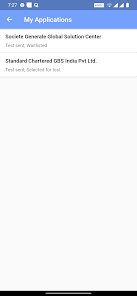

    
    <h1>Placement V2</h1>

     &emsp;
     &emsp;
     &emsp;
     &emsp;
     &emsp;
     &emsp;

 

## Download for Android

Get the APK from [Placement V2 releases](https://github.com/HUKA-Taro/placementv2/releases). If you previously installed a debug build of this V2 app, uninstall that build first and sign in again after installing the release.

## About the app
Placement V2 is an unofficial, extensively modified Android app built on [IMG's Placement Flutter](https://github.com/IMGIITRoorkee/placement-flutter). The original app and design are by the Information Management Group (IMG), IIT Roorkee. V2 changes are by HUKA_Taro.

The Android app uses your Channel i account for placement listings, applications, deadlines, and results. Current builds can filter a branch result by company and a company result by branch.

## Features
- Sign in with your Channel i account.
- Apply to companies straight from your phone, without opening Channel i.
- Track upcoming application deadlines in a dedicated tab.
- Browse placement results branch-wise or company-wise.
- Search and filter to narrow results down to what you need.

## Terms of Service
Terms to Service: https://docs.google.com/document/d/1vsbooZi9PIiVIMaLts2wv0tODEJafCaRT41zsENYN3I/edit

## Contributing
- Fork the repository to your account.
- Branch out to `a_meaningful_branch_name`.
- Commit your changes.
- File a `Pull request`.
- Get your pull request merged.

It's that simple!

## Credits

## Placement V2 notifications

This app is based on IMG's Placement Flutter app and adds independent push alerts for changes in the current-season placement company results index. **Automatic alerts require the custom backend.** The backend checks for updates and sends Firebase pushes while it is running. Other app features use Channel i. Contact [HUKA_Taro](https://github.com/HUKA-Taro) if you need access to host the checker locally.

For Android, register package `com.huka.taro.placementv2` in the Firebase project you control, download its `google-services.json` into `android/app/`, and run `flutter pub get`. The app displays alerts while open, and Android displays them in the background after the app has been opened and notification permission granted. Force-stopping the app blocks delivery until it is opened again.

## Check the notification backend

Open **Profile > Notification settings** to see whether the checker is online,
offline, or running with a feed that is not ready. The app refreshes the status
every 30 seconds while this screen is open. Tap the refresh icon to check again.
The status becomes available once the checker host configures and publishes its
Firestore heartbeat. If Firestore cannot be reached, the app reports that it
could not verify the status.
The public checker sends placement result alerts. The deadline preference is reserved for a backend that supports deadline alerts.
